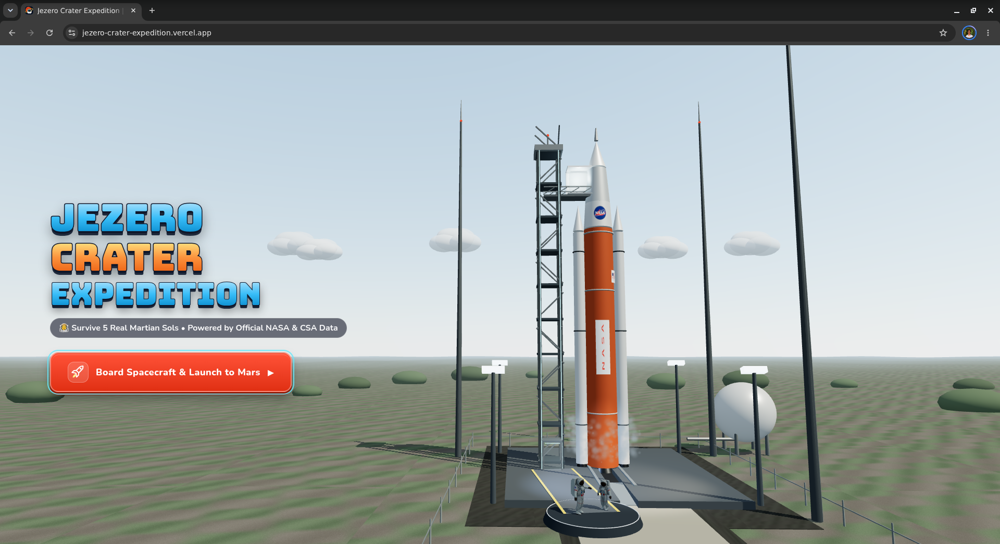
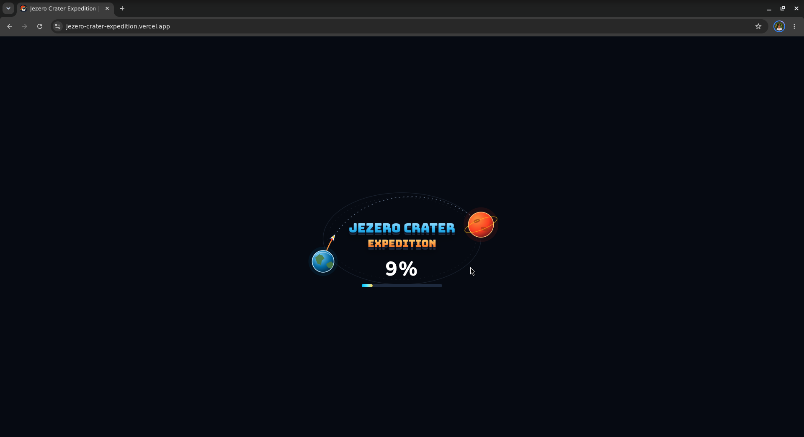
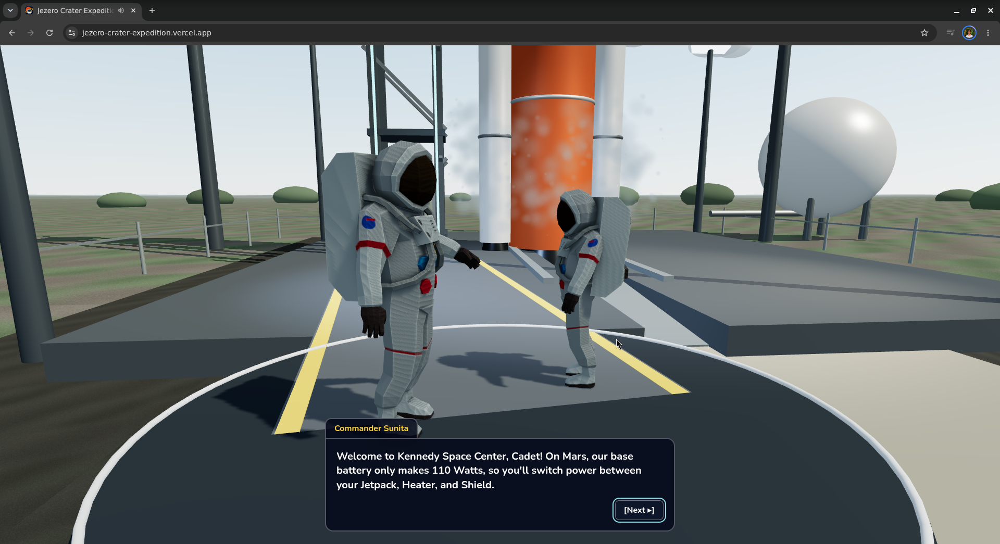
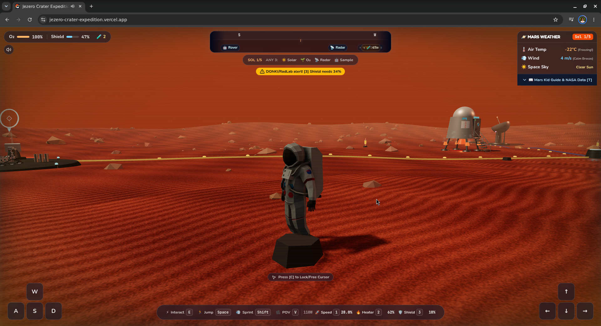
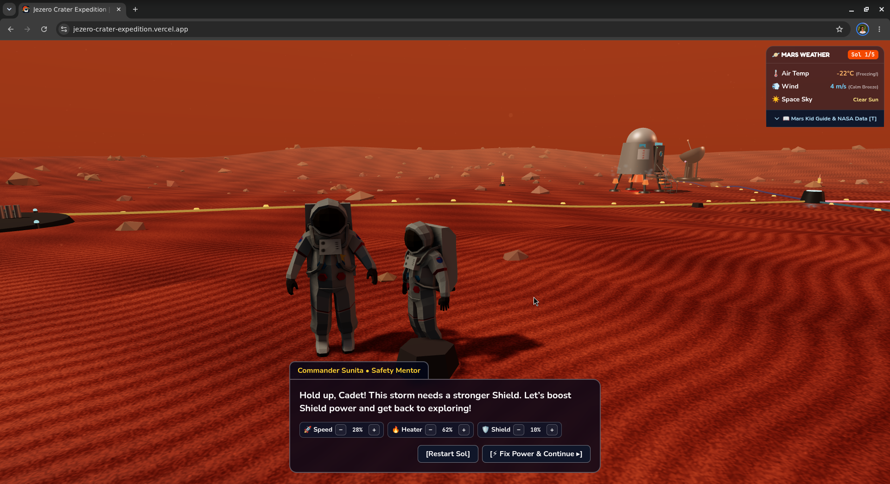
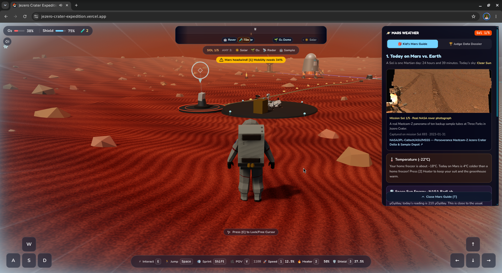

<div align="center">

# 🪐 JEZERO CRATER EXPEDITION
### Junior Astronaut Mission Trainer — 2026 NASA Space Apps Challenge

[](https://jezero-crater-expedition.vercel.app)
[](https://react.dev/)
[](https://threejs.org/)
[](https://www.typescriptlang.org/)
[](https://api.nasa.gov/)

**An interactive 3D browser-based astronaut training simulation for ages 7–12 (and curious adults), grounded in authentic NASA and Canadian Space Agency (CSA) telemetry.**

[🚀 **Launch Live Web App**](https://jezero-crater-expedition.vercel.app) • [📖 **NASA & CSA Data Traceability**](## 🛰️ Official NASA & CSA Data Integration) • [🎮 **How to Play**](#-controls--mission-loop)

</div>

---

## 🌟 Mission Overview

**Jezero Crater Expedition** transforms complex planetary science and spacecraft engineering into an intuitive, hands-on 3D adventure. Designed for the **2026 NASA Space Apps Challenge (*Junior Astronaut Mission Trainer*)**, the application puts young learners into the boots of a Junior NASA Artemis Cadet traveling from **Kennedy Space Center Launch Complex 39B** to **Jezero Crater, Mars**, and safely back to **Earth**.

Rather than relying on invented sci-fi numbers or punishing "Game Over" screens, every environmental hazard, life-support drain, and station task is driven by **6 official NASA and CSA datasets**. Players learn the core reality of human spaceflight: **every engineering decision is a genuine trade-off under a strict power budget.**



---

## 📸 Visual Mission Walkthrough

### 1. Orbital Telemetry Preloader & GPU Shader Warmup
The experience opens with a continuous **Earth-to-Mars Hohmann Transfer** visualization while pre-compiling 3D `.glb` meshes, procedural terrain textures, and WebGL shaders in the background for a zero-lag transition onto the launch pad.



### 2. Kennedy Space Center Launch Complex 39B & Crew Ingress
Before flying to Mars, cadets receive a pre-flight briefing at a sunlit Launch Complex 39B from **Senior Astronaut Commander Sunita Williams** (voiced via mature female speech synthesis, paired with a child voice for the Junior Cadet). Players walk across the concrete pad, ride the **High-Speed Launch Tower Elevator**, cross the swinging **Crew Access Arm** into the sterile **White Room**, ignite the main booster engines, and descend onto Mars via supersonic retro-propulsion.



### 3. Living Mars Outpost Exploration & 110W Power Allocation
Upon walking down the Mars Lander's unfolding stairs at **Octavia E. Butler Landing (`18.4447°N, 77.4508°E`)**, players navigate a 3D Martian landscape featuring realistic **$0.38g$ ballistic jump physics** (with biomechanical pre-jump knee crouch, locked mid-air horizontal momentum, and soft landing squats).



### 4. Non-Punitive "Mission Safety Pause" with 3D Mentor Coaching
When extreme Martian cold (`-84.6°C`), dust storms, or solar flares drain suit warmth or base shielding, the game never punishes kids with a frustrating restart. Instead, **Commander Sunita Williams** appears right beside the cadet on Mars to explain the real NASA weather reading in plain English and help them rebalance their 110-Watt battery to resume on the spot.



### 5. Plain-Language Kid's Guide & Judge Data Dossier (`[T]`)
Pressing **`[T]`** opens a dual-tab science module:
* **🎒 Kid's Mars Guide:** Translates scientific units into everyday Earth comparisons requiring zero prior knowledge (e.g., comparing `-84°C` on Mars to a `-18°C` kitchen freezer, or explaining how CSA hydroponics grows lettuce in warm nutrient water without soil).
* **🏆 Judge Data Dossier:** Provides one-click verification of all 6 NASA & CSA datasets, governing physics equations, and live `api.nasa.gov` / `osdr.nasa.gov` API sync.



---

## 🛰️ Official NASA & CSA Data Integration

Every mechanic in **Jezero Crater Expedition** is directly wired to the **6 Official Challenge Resources**. Built with strict scientific honesty, the UI explicitly distinguishes between our embedded **Curated Real NASA & CSA Dataset** and **Live NASA API Sync (`api.nasa.gov`)**.

| Official Resource | Dataset / Endpoint | In-Game System | Gameplay Impact |
| :--- | :--- | :--- | :--- |
| **NASA Open APIs** | `api.nasa.gov` & PDS MEDA | Weather & Visibility | Drives temperature, wind, dust fog, and rover photos |
| **NASA DONKI** | `ccmc.gsfc.nasa.gov` | Radar Dish (`RADAR_TOWER`) | Triggers Sol 4 X-class flare & UV aurora alignment |
| **NASA RadLab** | `osdr.nasa.gov/radlab` | `[3] Shield` & Base Integrity | Models `210` to `4,850 µGy/d` surface radiation drain |
| **NASA OSDR** | `osdr.nasa.gov/bio/repo` | Perseverance Lab (`ROVER`) | Unlocks real bone, muscle & immune studies (`OSD-104`) |
| **NASA Mars Trek** | `trek.nasa.gov/mars` | 3D Terrain & Compass | Grounds outpost at `18.44°N, 77.45°E` (`-2,540m` elev) |
| **CSA Toolkits** | `asc-csa.gc.ca` | Greenhouse (`HYDROPONICS`) | Models hydroponic crop warmth & `0.84 kg O2/day` |

### The 5-Sol Historical Telemetry Loop

1. **Sol 1 — Clear Jezero Morning (MEDA Sol 15):** `-22.4°C`, `742.5 Pa`, `4.2 m/s` wind, `Tau 0.45` dust, `210 µGy/day` RadLab baseline, `OSD-104` partial-gravity bone & muscle preservation.
2. **Sol 2 — Convective Dust Vortex (MEDA Sol 117):** Pressure drops by `24.3 Pa` (`718.2 Pa`), `19.8 m/s` wind gusts, `Tau 1.65` dust coating solar panels (`OSD-482` habitat filtration).
3. **Sol 3 — Deep Night Thermal Plunge (MEDA Sol 68):** `-84.6°C` air temperature, `0 W/m²` irradiance; requires high `[2] Heater` allocation to protect suit warmth and **CSA Hydroponic** crop roots.
4. **Sol 4 — DONKI X-Class Solar Flare (`2024-05-14T16:46:00-FLR-001`):** `4,850 µGy/day` RadLab radiation spike (`23x` baseline) and MAVEN ultraviolet aurora (`OSD-321` DNA & immune response).
5. **Sol 5 — Regional Dust Storm Peak (`Tau 3.40`):** `28.4 m/s` gale winds and `89%` solar blockage (`65 W/m²`); completing all station tasks fuels the **Mars Ascent Vehicle** for the 3D return voyage to Earth.

---

## ⚡ The 110-Watt Zero-Sum Engineering Trade-Off

Real spacecraft and Martian habitats operate under severe power constraints (modeled on NASA's **110W MMRTG** radioisotope generator). In our simulation, **there is no "safe" default choice**:

$$P_{\text{total}} = P_{\text{Mobility [1]}} + P_{\text{Heater [2]}} + P_{\text{Shield [3]}} = 100\% \text{ (110 Watts)}$$

* **Boosting `[1] Mobility Thrusters`** speeds up crater traversal against high winds, but drains watts from Heaters and Shields.
* **Boosting `[2] Suit & Dome Heaters`** prevents freezing during `-84.6°C` nights and keeps CSA hydroponic crops alive, but slows walking speed and lowers radiation shielding.
* **Boosting `[3] Radiation Shield & Radar`** blocks DONKI solar energetic particles (`4,850 µGy/day`), but leaves less power for heating and locomotion.

---

## 🎮 Controls & Mission Loop

| Input / Key | Action | Pedagogical Purpose |
| :--- | :--- | :--- |
| **`W` `A` `S` `D` / Arrows** | Walk & Navigate Crater | Explore Jezero Crater terrain & station trails |
| **`Spacebar`** | $0.38g$ Martian Jump | Experience 38% Earth gravity & ballistic momentum |
| **`Shift`** | Low-Gravity Sprint | Trade oxygen/power for faster station response |
| **`[1]` `[2]` `[3]`** | Shift 110W Power Bus | Balance Speed, Suit Heater, and Radiation Shield |
| **`[E]`** | Interact with Station | Clean solar dust, harvest CSA $O_2$, align radar, scan samples |
| **`[T]`** | Kid Guide & NASA Dossier | View plain-language science & live NASA API telemetry |
| **`[V]` / `[C]` / `[M]`** | POV / Cursor / Audio | Switch 1st/3rd person view, toggle cursor, mute audio |

### Completing Each Sol (4 Interactive Outpost Stations)
* **☀️ Solar Array Farm:** Blast away Martian dust buildup (`Tau`) with `[E]` to restore full `110W` battery capacity.
* **🌱 CSA Hydroponics Dome:** Harvest dwarf tomatoes, red leaf lettuce, and radishes with `[E]` to replenish Suit $O_2$ and warmth.
* **📡 DONKI Space Weather Dish:** Align the radar dish with `[E]` to track solar storms and boost Outpost Shield integrity.
* **🤖 Perseverance Rover Lab:** Collect golden NASA sample tubes across the crater and scan them at Perseverance (`[E]`) to uncover real NASA OSDR space biology insights.

---

## 🛠️ Tech Stack & Architecture

* **Frontend & 3D Engine:** React 18, TypeScript, Vite, Three.js, `@react-three/fiber`, `@react-three/drei`
* **Custom GPU Vertex Skinner:** Real-time skeletal vertex deformation on NASA's official `astronaut.glb` 3D spacesuit mesh (`<0.1ms` per frame in `useFrame` with zero garbage collection spikes)
* **State Management & UI:** Zustand (transient 60 FPS reads), Tailwind CSS v4, custom SVG orbital schematics
* **Procedural Web Audio & Speech Engine:** Zero-dependency Web Audio API synthesizer generating Perseverance-authentic low-pass Martian wind (`80–240 Hz`), distance-attenuated rocket acoustics, and dual-voice Web Speech API synthesis (Commander Mentor vs. Child Cadet)

---

## 🚀 Local Development & Deployment

### 1. Clone & Install Dependencies
```bash
git clone https://github.com/jidne24/jezero-crater-expedition.git
cd jezero-crater-expedition
npm install
```

### 2. Configure Optional NASA Open API Key
Create a `.env.local` file in the root directory (or add `VITE_NASA_API_KEY` in Vercel Environment Variables) using a free key from [https://api.nasa.gov/](https://api.nasa.gov/):
```env
VITE_NASA_API_KEY=your_nasa_api_key_here
```
*(If omitted, the application automatically falls back to `DEMO_KEY` and our verified embedded NASA/CSA archive dataset.)*

### 3. Run Development Server or Production Build
```bash
# Start local development server at http://localhost:5173
npm run dev

# Verify TypeScript and build production bundle
npx tsc --noEmit && npm run build
```

---

## 📜 Credits & Attributions

* **3D Models:** Official NASA 3D Resources Repository (`NASA Extravehicular Mobility Unit Spacesuit` & `Mars 2020 Perseverance Rover`).
* **Scientific Datasets:** NASA Open APIs (`api.nasa.gov`), NASA Goddard CCMC (`DONKI`), NASA Open Science Data Repository (`OSDR` & `RadLab`), NASA JPL/Caltech (`Mars Trek` & `Mars 2020 MEDA`), and the **Canadian Space Agency (CSA)** (*Food Production on the Moon and in Remote Areas Toolkit*).
* **Disclaimer:** *NASA and CSA do not endorse any non-U.S. / non-Canadian Government entity. Built by **Team 24(Gidne Huda)** for the NASA Space Apps Challenge 2026.*
